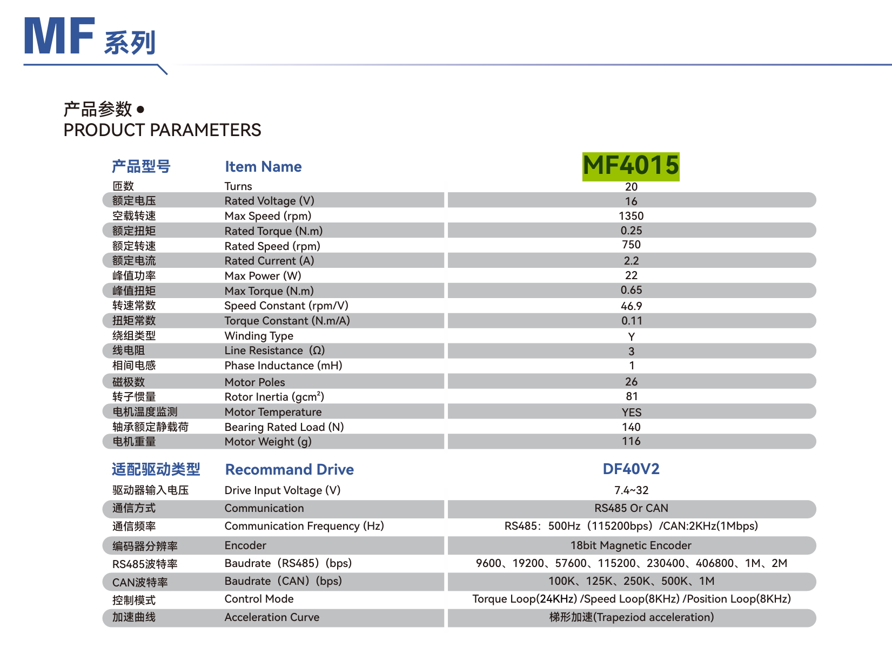
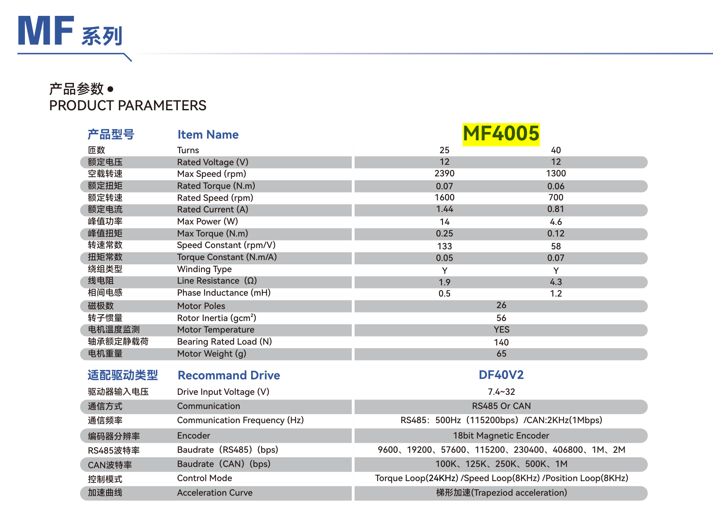
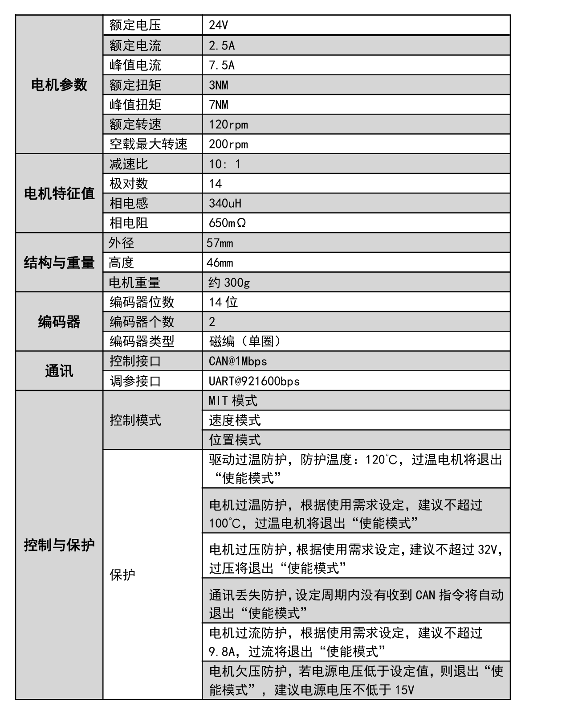
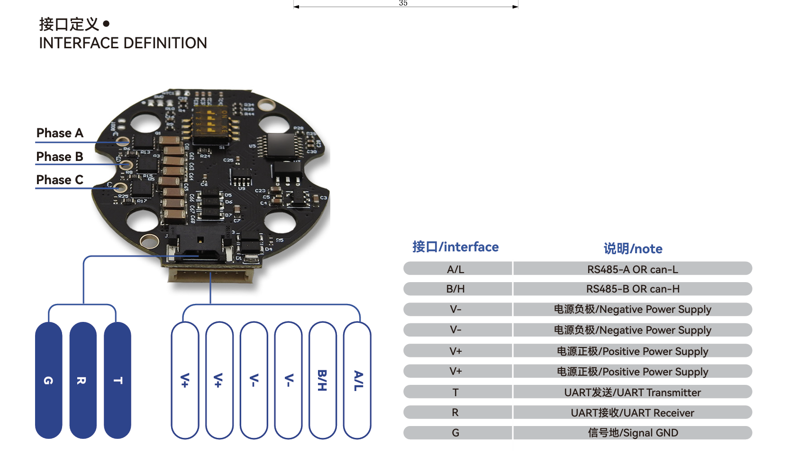
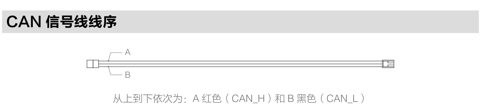
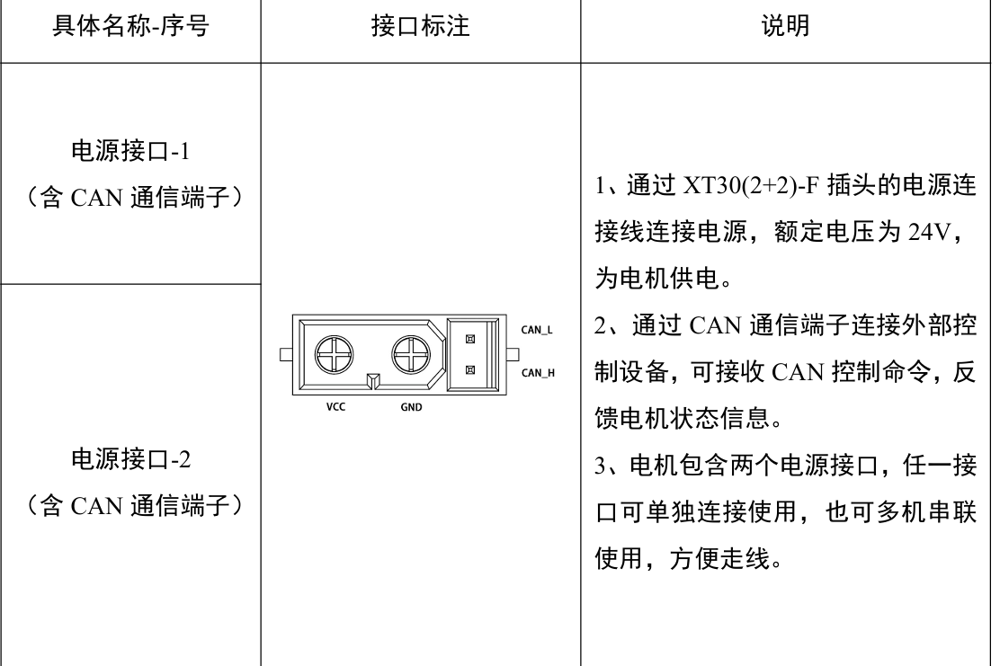

# 记录
3R-R-3R构型

//待确定
肩球:J0 GM6020
J1 DM-J4310
J2 GM6020
肘:J3 DM-J4310
腕球: J4 MF4015-V2
J5  MF4015-V2
J6  MF4015-V2

J6-J4 左H右L
J3同J1
J2同向
J1绿色L黄色H
J0反向

can分配
J0-J3 CAN1

J4-J6 CAN2
电机参数

MF4015/4005
接线

