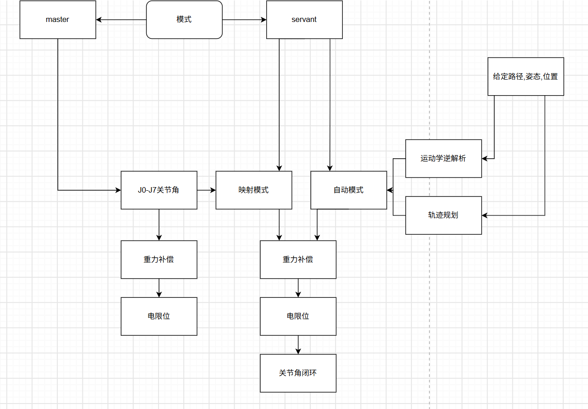

# 代码架构

* 状态机 
  * 分为主机和从机,两者公用一套代码

* arm_dynamics 描述机械臂动力学,暂时包含重力补偿,计算末端到近端重力矩的传播
* arm_kinematics 描述机械臂运动学,包含关节零点标定,正向运动学,解算末端到基座的变换矩阵,并且由此提取三维坐标和欧拉角,逆解析解,关节角规划,路径规划
* arm_jointctrl 输入关节角目标,描述机械臂关节控制逻辑,MIT/软件pid闭环控制,重力补偿逻辑,电限位逻辑